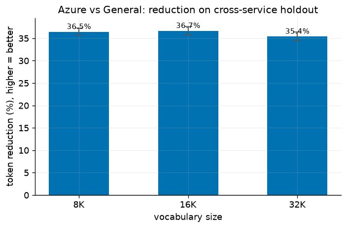
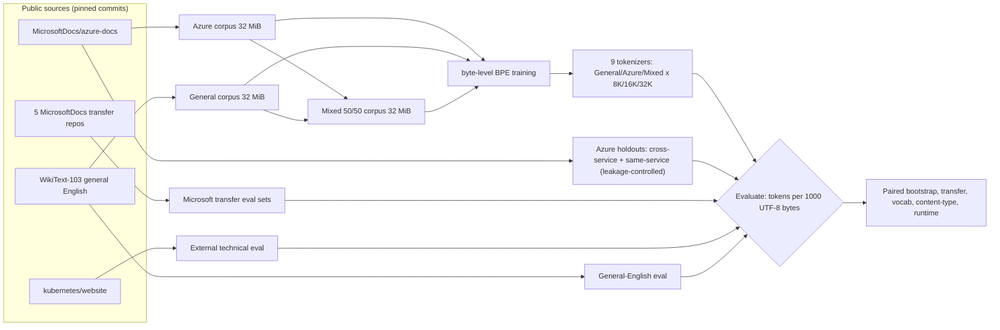

# Does Your Tokenizer Speak Cloud?

**A controlled, CPU-only study of how training-corpus specialization changes byte-level BPE tokenizer *compression* on Microsoft technical documentation.**

This repository is a reproducible research artifact. It trains byte-level BPE tokenizers on byte-matched corpora and measures how many tokens each needs to encode unseen documentation. It measures **tokenization only**.

> **Scope.** This project measures tokenizer compression (tokens per unit of text), token coverage, vocabulary utilization, and CPU tokenizer throughput. It makes **no** claim about model output quality, accuracy, reasoning, inference latency, GPU throughput, or realized cost. It is **not** an official Microsoft result. See [*What this measures / does not measure*](#what-this-measures) below.

## Primary result (16K slice)

The **primary result uses the 16K vocabulary slice**. Under a fixed **32 MiB** byte-matched training budget, a fixed byte-level BPE implementation, and a matched **16K** vocabulary, the **Azure-trained** tokenizer uses **36.68% fewer tokens per 1,000 UTF-8 bytes** than the **byte-matched General-English** tokenizer on an **unseen cross-service Azure holdout** (five whole held-out Azure services, 964 documents):

- Azure: **240.18** tokens / 1,000 UTF-8 bytes · General: **379.30** · relative reduction **36.68%**
- 95% paired-bootstrap CI **[35.77%, 37.62%]** · document win rate **1.000**

The primary comparison is **controlled** (Track A): General, Azure, and Mixed tokenizers are identical in algorithm, pre-tokenizer, decoder, normalization, special tokens, vocabulary size, and training bytes — only the training corpus differs. Production tokenizers (`tiktoken`) are **Track B — observational baselines only**; they differ in training data, vocabulary, normalization, algorithm, and intended model, and are never treated as a controlled comparison.



*Relative token reduction (%) of the Azure vs byte-matched General tokenizer on the cross-service holdout at 8K/16K/32K vocabularies; error bars are 95% paired-bootstrap CIs. Higher is better. Source: [`results/tables/fig01_primary_reduction.csv`](results/tables/fig01_primary_reduction.csv).*

## The specialization–generalization tradeoff

Full specialization has a cost, and a mixed corpus mostly avoids it (all relative to the General tokenizer, 16K):

| Tokenizer | Azure cross-service holdout | Held-out general English |
|---|---:|---:|
| **Azure** | **+36.68%** (fewer tokens) | **−34.75%** (regression) |
| **Mixed (50/50)** | **+34.21%** | **−4.39%** |
| General | 0 (reference) | 0 (reference) |

The **Mixed** tokenizer keeps most of the Azure-domain compression gain while nearly eliminating the general-English penalty.

## Compact results (16K, Azure vs General)

| Dimension | Result |
|---|---|
| Primary (Azure cross-service holdout) | **+36.68%**, 95% CI [35.77, 37.62], win rate 1.000, n=964 |
| General-English regression | **−34.75%**, 95% CI [−35.10, −34.40] |
| Transfer: Azure same-service | +35.03% |
| Transfer: Microsoft data docs | +32.94% |
| Transfer: Microsoft DevOps docs | +31.76% |
| Transfer: Kubernetes (external technical) | +31.18% |
| Transfer: Microsoft architecture docs | +26.03% |
| Transfer: Microsoft broad-enterprise docs | +25.89% |
| Vocabulary stability (8K / 16K / 32K) | +36.46% / +36.68% / +35.41% |
| Content type: prose-dominant (n=900) | +36.75% (not only code/markup) |
| Coverage | 59,160 rows, 12 encoders × 9 eval sets; 100% exact round-trip; 0 `[UNK]` |
| CPU tokenizer throughput (median) | Track A 5.1–5.5 MB/s; Track B `tiktoken` 11.6–19.8 MB/s |

Every number above is registered in [`publication/claims.yaml`](publication/claims.yaml) and re-checked against its source file by `make verify-claims` (44/44). More figures and tables: [`docs/results.md`](docs/results.md), [`results/figures/FIGURES.md`](results/figures/FIGURES.md).

## Experimental design



- **Byte-matched** corpora: all three are exactly 33,554,432 UTF-8 bytes.
- **Primary slice:** 16K vocabulary. **Principal holdout:** cross-service (whole Azure services never seen in training).
- **Leakage controls:** whole services held out; exact + near-duplicate removal; general corpus exact-deduplicated before the train/eval split; cross-corpus near-duplicate evaluation items removed. See [`docs/experiment-design.md`](docs/experiment-design.md).

## What this measures

- Token count and compression (tokens per 1,000 UTF-8 bytes) on fixed, held-out corpora.
- Cross-service and cross-repository transfer, and the general-English regression.
- Prose-vs-technical-syntax effects, vocabulary utilization, identifier fragmentation.
- Exact round-trip coverage and `[UNK]` rate.
- CPU tokenizer encode/decode throughput (Track A controlled; Track B observational).

## What this does not measure

- **Not** LLM output quality, accuracy, reasoning, or safety.
- **Not** a drop-in tokenizer swap for an already-trained model (embeddings are tied to the vocabulary).
- **Not** inference latency, GPU throughput, or realized dollar cost — a 36.68% token reduction is **not** a 36.68% latency or cost reduction.
- **Not** a claim of universal domain-tokenizer superiority, nor an official Microsoft position.
- Context-window and token-billing figures, where mentioned, are **derived estimates**, not measured outcomes.

## Repository map

| Path | Contents |
|---|---|
| `src/msdocs_tokenizer/` | pipeline library + `msdocs-tok` CLI |
| `configs/` | frozen experiment + source configs |
| `data/manifests/`, `data/audit/` | source pins, checksums, dedup/split audit (raw corpora are **not** committed) |
| `results/` | raw per-document rows, processed tables, figures, reports ([guide](results/README.md)) |
| `artifacts/tokenizers/*.json` | tokenizer provenance + `distributable` flags (the `tokenizer.json` artifacts are **not** committed) |
| `docs/` | [design](docs/experiment-design.md) · [methodology](docs/methodology.md) · [datasets & licenses](docs/datasets-and-licenses.md) · [reproducibility](docs/reproducibility.md) · [results](docs/results.md) · [limitations](docs/limitations.md) · [repo map](docs/repository-map.md) · [artifact eval](docs/artifact-evaluation.md) |
| `paper/` | arXiv LaTeX manuscript (in preparation) |
| `publication/` | claim registry, audits, reviews, publication state |
| `notebooks/` | explanatory notebooks (not the core execution path) |
| `research/` | frozen experiment spec, deviations, red-team review |

## Quick reproduction (no downloads — from committed results)

Verify the published numbers and regenerate figures/reports from the committed result files, with **no corpus download**:

```bash
uv sync                       # Python 3.12 environment (~1-2 min)
bash scripts/doctor.sh        # environment preflight
make verify                   # re-check existing artifacts (8/8), no retraining
make verify-claims            # reconcile every registered number (44/44)
make figures report           # regenerate figures + result summaries
```

Runs in a few minutes; needs **no network** and only megabytes of the committed results (well under 1 GB RAM).

## Full reproduction (downloads pinned public sources)

```bash
make acquire-full audit-full  # clone/pin sources + build byte-matched corpora
make train-all evaluate-all   # train 9 tokenizers + evaluate
PROFILE=full make analyze report figures verify
```

**Expected resource usage:** acquisition ~11 min (network), audit ~4 min, training ~1 min, evaluation ~5 min (≈20–25 min wall total on an Apple M3 Pro); transient disk ~2.7 GB (git-ignored source clone ~2.2 GB + working data ~0.5 GB); peak memory a few GB. See [`docs/reproducibility.md`](docs/reproducibility.md) for per-path time/disk/memory and determinism notes (single seed `20260709`).

## Data acquisition and licensing

Raw source corpora are **not** redistributed here, and reproduction may require downloading the pinned public sources. Sources are public and pinned by commit in [`data/manifests/sources.lock.json`](data/manifests/sources.lock.json); licenses and attribution are in [`licenses/`](licenses/) and [`docs/datasets-and-licenses.md`](docs/datasets-and-licenses.md). Microsoft documentation sources are CC-BY-4.0; Kubernetes website content is CC-BY-4.0; WikiText is CC-BY-SA (local-use-only). We publish only scripts, manifests, hashes, and aggregate results. The Azure-only tokenizer artifact is distributable with attribution; the General and Mixed (WikiText-derived) tokenizers are local-use-only.

## Result verification

Every displayed number is registered in [`publication/claims.yaml`](publication/claims.yaml) and verified by:

```bash
make verify-claims   # extracts each number from its source file, checks within tolerance
```

See the claim ledger: [`publication/CLAIM_LEDGER.md`](publication/CLAIM_LEDGER.md).

## Paper

An arXiv-ready manuscript is in [`paper/`](paper/) (in preparation). It reports the same registered numbers.

## Citation

Please cite via [`CITATION.cff`](CITATION.cff). Author and affiliation fields are **placeholders** pending confirmation ([`publication/AUTHOR_INPUTS_REQUIRED.md`](publication/AUTHOR_INPUTS_REQUIRED.md)).

## Limitations

Key limitations include the 32 MiB training budget, a single tokenizer algorithm for the controlled matrix, and the fact that comparing Azure documentation with general English changes more than subject domain (also technical style, markup, and identifier density). Full discussion: [`docs/limitations.md`](docs/limitations.md).

## License and attribution

Original code and writing in this repository are licensed under the [MIT LICENSE](LICENSE) (which does **not** cover third-party corpora, generated tokenizer artifacts, Microsoft trademarks, or the paper). Third-party documentation sources retain their own licenses; see [`licenses/ATTRIBUTION.md`](licenses/ATTRIBUTION.md).

## Author and affiliation disclaimer

Author, affiliation, and any employer relationship are **not yet finalized** (placeholders pending confirmation — see [`publication/AUTHOR_INPUTS_REQUIRED.md`](publication/AUTHOR_INPUTS_REQUIRED.md)). This is an independent research artifact using only public documentation; it does not represent Microsoft's position and implies no endorsement.
