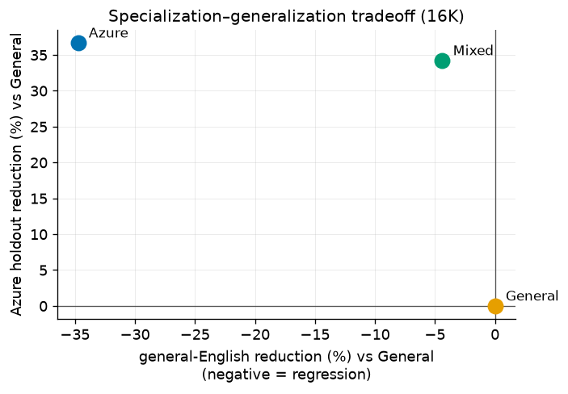
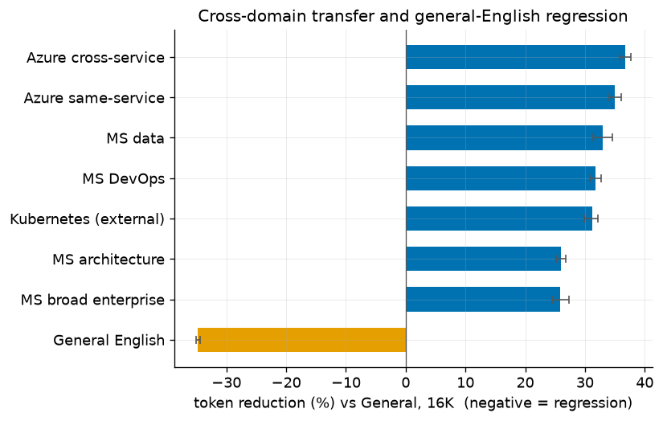
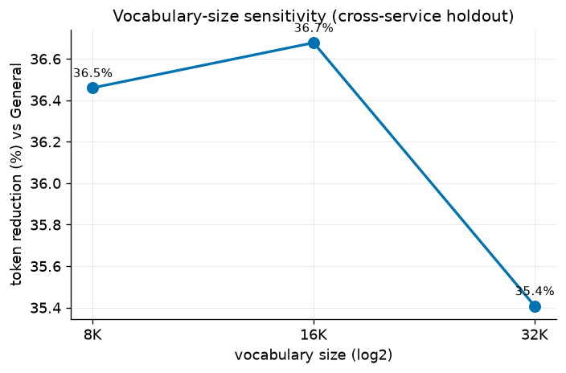
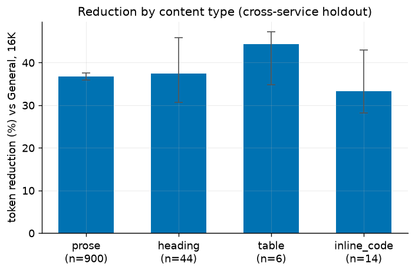
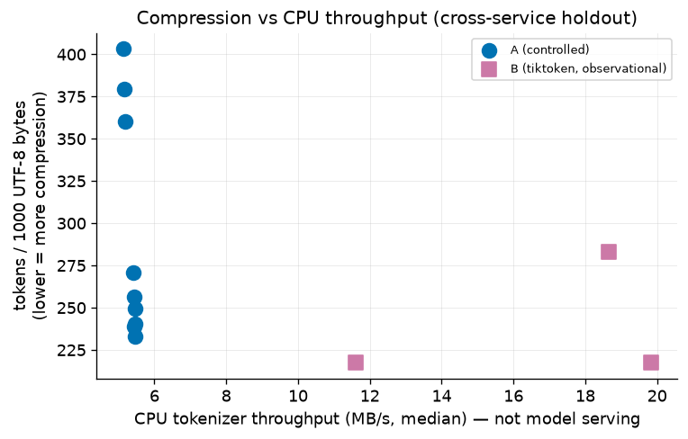

# Results

Every number below is registered in
[`../publication/claims.yaml`](../publication/claims.yaml) and re-checked against
its source file by `make verify-claims` (claim IDs in parentheses). All numbers
are the 16K slice unless stated. Positive relative reduction = the specialized
tokenizer uses **fewer** tokens. This is tokenization compression only.

## 1. Primary result — Azure cross-service holdout

On the principal held-out set (five whole Azure services never seen in training,
964 documents; `PRIMARY_N_DOCS`), the Azure-trained tokenizer uses **36.68% fewer
tokens per 1,000 UTF-8 bytes** than the byte-matched General tokenizer
(`PRIMARY_REDUCTION_16K`):

- Azure **240.18** vs General **379.30** tokens / 1,000 UTF-8 bytes
  (`PRIMARY_AZURE_TPK`, `PRIMARY_GENERAL_TPK`)
- 95% paired-bootstrap CI **[35.77%, 37.62%]** (`PRIMARY_CI_LOW`/`HIGH`)
- Document win rate **1.000** (`PRIMARY_WIN_RATE`)

## 2. General-English regression

Full specialization has a cost: on held-out general English the Azure tokenizer is
**−34.75%** (uses more tokens) relative to General (`GENERAL_REGRESSION_AZURE`;
95% CI [−35.10%, −34.40%], `GENERAL_REGRESSION_CI_LOW`/`HIGH`).

## 3. Mixed-tokenizer tradeoff

The 50/50 Mixed tokenizer retains **93.3%** of the Azure-only in-domain gain
(`MIXED_RETAINED_FRACTION`) with a much smaller general-English cost:

| Tokenizer | Azure cross-service holdout | General English |
|---|---:|---:|
| Azure | 36.68% fewer tokens (`PRIMARY_REDUCTION_16K`) | 34.75% more tokens (`GENERAL_REGRESSION_AZURE`) |
| Mixed | 34.21% fewer tokens (`MIXED_REDUCTION_PRINCIPAL`) | 4.39% more tokens (`MIXED_REGRESSION`) |

## 4. Transfer across documentation domains

Azure vs General (16K), positive = Azure uses fewer tokens (all CIs exclude zero):

| Evaluation set | Relative reduction | Claim ID |
|---|---:|---|
| Azure same-service holdout | +35.03% | `TRANSFER_SAME_SERVICE` |
| Microsoft data docs (SQL, Fabric) | +32.94% | `TRANSFER_MS_DATA` |
| Microsoft DevOps docs | +31.76% | `TRANSFER_MS_DEVOPS` |
| Kubernetes (external technical) | +31.18% | `TRANSFER_KUBERNETES` |
| Microsoft architecture docs | +26.03% | `TRANSFER_MS_ARCH` |
| Microsoft broad-enterprise docs | +25.89% | `TRANSFER_MS_BROAD` |

The advantage decays with domain distance and persists on non-Microsoft
Kubernetes documentation.

## 5. Vocabulary-size sensitivity

The relative reduction on the principal holdout is stable across the tested
vocabulary range:

| Vocabulary | Reduction | Claim ID |
|---|---:|---|
| 8K | +36.46% | `VOCAB_8192` |
| 16K | +36.68% | `VOCAB_16384` |
| 32K | +35.41% | `VOCAB_32768` |

Stability across 8K/16K/32K suggests corpus composition mattered more than the
tested vocabulary range.

## 6. Content-type analysis

On the principal holdout, by dominant content type (Azure vs General, 16K):

| Content type | Reduction | Claim ID |
|---|---:|---|
| Prose-dominant (n=900, `CONTENT_PROSE_N`) | +36.75% (`CONTENT_PROSE`), 95% CI [35.87%, 37.63%] |
| Headings | +37.49% | `CONTENT_HEADING` |
| Tables | +44.30% | `CONTENT_TABLE` |
| Inline code | +33.28% | `CONTENT_INLINE_CODE` |

The prose stratum (the largest, n=900) still shows a large reduction, so the
effect is **not** explained only by code fences or configuration syntax.

## 7. Coverage and correctness

Across **12 encoders × 9 evaluation sets = 59,160 rows** (`COVERAGE_ROWS`,
`COVERAGE_ENCODERS`, `COVERAGE_EVALSETS`):

- **100%** exact encode→decode round-trip (`COVERAGE_ROUNDTRIP_OK` = true)
- **0** `[UNK]` occurrences (`COVERAGE_UNK`)

Byte-level BPE provides complete UTF-8 coverage by construction.

## 8. CPU runtime (separate from compression)

Median CPU tokenizer throughput:

- Track A (controlled) tokenizers: **5.13–5.47 MB/s**
  (`RUNTIME_TRACKA_MIN`/`MAX`)
- Track B `tiktoken` baselines: **11.61–19.83 MB/s**
  (`RUNTIME_TRACKB_MIN`/`MAX`)

The controlled tokenizers compress more but run slower on CPU than the
production-optimized `tiktoken` baselines. Compression efficiency and CPU
throughput are distinct dimensions. This is CPU tokenizer throughput on a
thermally variable laptop, **not** model-serving throughput.

## Negative / null and caveats

- The **general-English regression** (§2) is a genuine negative result of full
  specialization and is reported beside the gains.
- The Azure-vs-general-English comparison changes more than subject domain (style,
  markup, identifier density); see [limitations](limitations.md).
- Track B (`tiktoken`) numbers are **observational**, not a controlled comparison.
- Context-window/billing figures elsewhere are derived **estimates**.

Source tables and figure provenance: [`../results/README.md`](../results/README.md),
[`../results/figures/FIGURES.md`](../results/figures/FIGURES.md). Full narrative:
[`../results/reports/FINAL_REPORT.md`](../results/reports/FINAL_REPORT.md).
